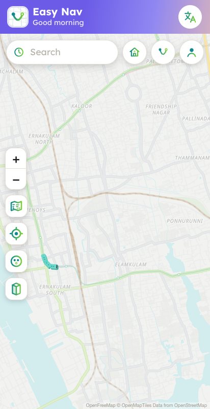
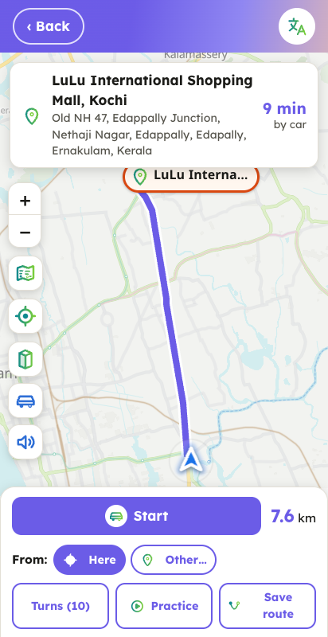
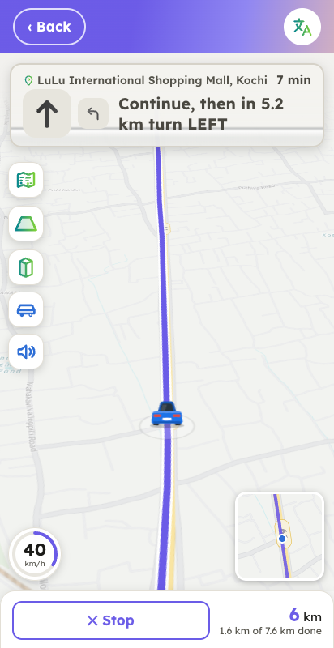
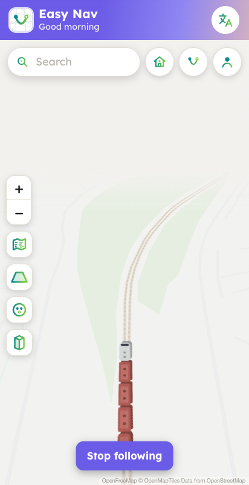

# Easy Nav App

**A calm, clutter-free navigation app for Android and the web, with big, readable text.**

Easy Nav is an Android navigation app I designed and built for people who find the usual map apps too busy. It shows only what matters, uses large readable text and clear words, never loses anything by accident, and follows your own saved routes turn by turn.

🌐 **Website:** https://anand-bhadran.github.io/easy-nav/
🔒 The app's source code is private. This page shows what the app does and how it's built; the files in this repo are the app's website.

  
  
  
  

Home map · Route preview · Driving view · Following a train

## What it does

**Navigation**
- Turn-by-turn voice guidance in two languages, with big turn cards.
- **Your own routes:** draw the way you really go and follow it turn by turn.
- **Practice drive:** watch a simulated run of a trip before doing it for real.
- **Smart rerouting:** after a wrong turn it prefers named roads, and offers to rejoin your saved route.
- **Alternative routes** shown side by side, chosen with a tap.
- **Tilted driving view** that turns with the phone, with your vehicle (car, scooter, walking) on the road.
- **Picture-in-picture:** the next turn stays on screen over other apps.
- Background navigation with a notification, and a keep-awake screen.

**A map that stays uncluttered**
- Only what matters: smaller roads fade when zoomed out, and only one saved route shows at a time.
- **Forgiving search** that handles spelling variants of local place names and finger slips.
- Saved places, homes and routes, each in a few taps; deleting always takes two taps.
- **Way to the door:** share the last stretch inside a gated compound as a link anyone can open.

**Small touches**
- Moving metro trains, water-metro boats, buses and rickshaws make the map feel alive. Tap one and the camera rides along behind it, like a game.
- Light and dark themes, a satellite view, offline map caching, and a speedometer.

## How it's built

| | |
|---|---|
| **App** | Vue 3 (Composition API) and Vite |
| **Maps** | Leaflet with MapLibre GL vector roads; a custom 3D tilt and rotation layer |
| **Routing** | OSRM (with alternatives and bearings), Photon and Nominatim search |
| **Android** | Capacitor 7, plus native Java plugins for a foreground navigation service, picture-in-picture and alarms |
| **Web** | The same Vue codebase also builds a browser version (in testing) |
| **Backend** | Python (FastAPI) for shared saved places |
| **Website** | A three.js animated hero on GitHub Pages |

About 12,000 lines of app code: Vue, JavaScript, CSS and Java.

### A few problems worth solving
- **A tilted, rotating map on Leaflet**, which has neither built in. I wrote a perspective and rotation layer that keeps labels upright, keeps you low on the screen, and hazes the horizon.
- **Smooth moving vehicles at sub-pixel precision.** Multi-carriage trains stay coupled round bends and through zooms. Each vehicle's position correction is applied outside the CSS scaling, so nothing jitters.
- **Privacy by design.** Personal homes and routes never ship inside the app build; an automated check confirms it on every build.
- **Accessible UX.** Big tap targets, clear words instead of icons alone, short voice prompts, and nothing destructive in one tap.

---

Made by **Anand Bhadran**, designer and builder.
